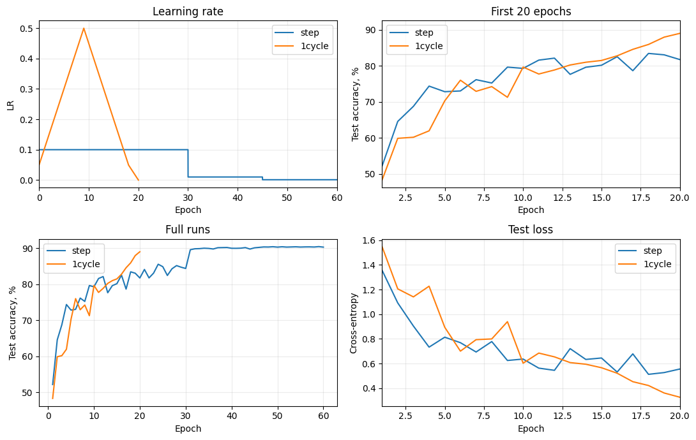

## Отчет по воспроизведению результатов статьи Super-Convergence: Very Fast Training of Neural Networks Using Large Learning Rates

### Данные:

CIFAR10 -- 50 000 train set, 10 000 test set

### Модель: 

CIFAR ResNet-20

### Параметры baseline обучения:

- SGD
- momentum 0.9
- 60 эпох
- LR уменьшается с 0.1 до 0.01 до 0.001 после 30й и 45й эпохи
- batch size 128
- weight decay 1e-4

### Параметры 1cycle обучения:

- SGD
- momentum 0.95 до 0.85 до 0.95
- 20 эпох
- LR изменяется след. образом -- с 0.05 до 0.5 до 0.05 до 0.000005

## Результаты:

| Метод | Эпохи | test accuracy | Время обучения |
|---|---:|---:|---:|
| Baseline | 60 | 90,34% | 1391,5 с |
| 1cycle | 20 | 89,05% | 463,9 с |

При одинаковом бюджете в 20 эпох точность 1cycle составила 89,05%, а baseline — 81,77%.

Полный запуск 1cycle занял примерно втрое меньше времени, при этом итоговая точность оказалась ниже на 1,29%. Точность 85% была впервые достигнута на 18-й эпохе за 418,2 с для 1cycle и на 24-й эпохе за 525,4 с для baselin, что на 20% быстрее бейзлайна.

Таким образом, удалось продемонстрировать преимущество 1cycle при ограниченном бюджете обучения

